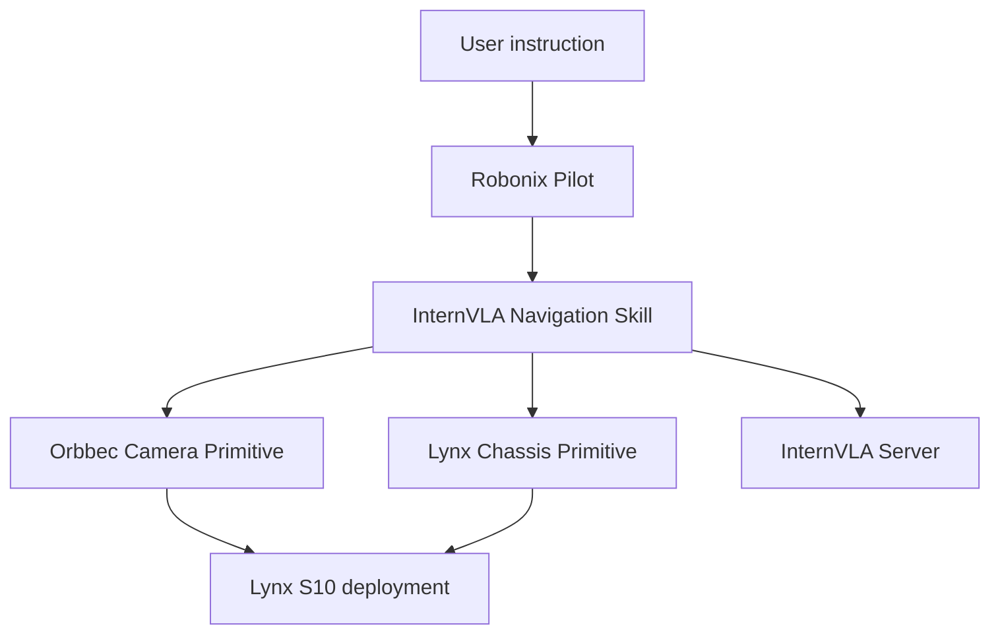

# DeepRobotics Lynx S10 Robot for Robonix

This repository defines a Robonix deployment for the DeepRobotics Lynx S10 wheeled quadruped. It describes the robot body to Soma, configures the Robonix system services, and assembles the hardware Primitives and high-level Skills used by the robot.

The repository is the integration layer for the complete robot. Device drivers and task logic remain in independent packages:

- The Orbbec camera Primitive provides RGB-D sensing.
- The Lynx chassis Primitive translates standard Robonix chassis commands into the Lynx UDP protocol.
- The InternVLA Navigation Skill performs closed-loop vision-language navigation.

Keeping these packages separate allows the robot description, device drivers, and task logic to evolve independently while communicating through standard Robonix capabilities.

## Features

- Registers the DeepRobotics Lynx S10 as a wheeled quadruped in Soma.
- Loads the robot URDF and identifies `base_link` as the root frame.
- Starts the standard Robonix system services: Atlas, Soma, Executor, Pilot, and Liaison.
- Integrates an Orbbec Gemini 336L camera through the Orbbec camera Primitive.
- Integrates Lynx chassis motion through the standard `robonix/primitive/chassis/move` capability.
- Supports natural-language visual navigation through the InternVLA Navigation Skill.
- Keeps hardware-specific control parameters in the chassis Primitive rather than in the robot description or navigation Skill.
- Supports both ratio-based and direct-value Lynx control through deployment configuration.

## Architecture



Pilot interprets the user's request and dispatches the navigation Skill. During navigation, the Skill captures an RGB image, requests an action from the separately running InternVLA server, and sends a generic distance or angle command to the chassis Primitive. The chassis Primitive alone is responsible for converting that command into Lynx-specific UDP control values.

## Repository layout

```text
robot-deep_robotics-lynx_s10/
├── .env.example
├── LICENSE
├── README.md
├── robonix_manifest.yaml
├── soma.yaml
└── urdf/
    └── lynx_s10.urdf
```

The Primitive and Skill packages are normally kept as sibling repositories and referenced from `robonix_manifest.yaml`:

```text
workspace/
├── robot-deep_robotics-lynx_s10/
├── primitive-orbbec-camera/
├── primitive-deep-robotics-lynx-chassis-rbnx/
└── skill-internvla-navigation-rbnx/
```

## Robot description

The `soma.yaml` file provides the semantic description of the physical robot:

```yaml
urdf:
  path: ./urdf/lynx_s10.urdf
  root_link: base_link
  model_name: deep_robotics_lynx_s10

robot:
  id: lynx_s10_01
  display_name: DEEP Robotics Lynx S10
  family: wheeled_quadruped
  root_part: base
  components:
    - id: base
      type: mobile_base
      urdf_link: base_link
```

The URDF supplies the robot's link and joint structure, while `soma.yaml` supplies the semantic identity that Robonix uses to reason about the robot and associate capabilities with its components.

If the chassis or camera capabilities are exported from `soma.yaml`, their `provider_id` values must match the package names used in `robonix_manifest.yaml`.

## Requirements

### Hardware

- DeepRobotics Lynx S10 wheeled quadruped.
- A Linux host capable of running Robonix. The current deployment has been tested on NVIDIA Jetson AGX Orin.
- Network connectivity from the host to the Lynx UDP control endpoint.
- Orbbec Gemini 336L RGB-D camera connected to the host when camera navigation is enabled.
- A clear test area and access to the manufacturer's manual control or emergency-stop mechanism.

### Software

- Ubuntu 22.04.
- Robonix CLI (`rbnx`).
- ROS 2 Humble for the Orbbec camera package.
- Python 3.10 or later for the native Primitive and Skill packages.
- Docker when required by a selected package.
- A separately running InternVLA inference server for InternVLA navigation.
- Access to an OpenAI-compatible VLM endpoint for Robonix Pilot.

### Related packages

The deployment expects these packages to be available at the paths configured in `robonix_manifest.yaml`:

| Package | Type | Purpose |
| --- | --- | --- |
| `primitive-orbbec-camera` | Primitive | Captures RGB-D data from the Orbbec camera |
| `primitive-deep-robotics-lynx-chassis-rbnx` | Primitive | Controls the Lynx chassis through UDP |
| `skill-internvla-navigation-rbnx` | Skill | Executes closed-loop vision-language navigation |

## Environment configuration

Pilot requires an OpenAI-compatible VLM endpoint. Create a `.env` file or export the following variables before booting the deployment:

```bash
export VLM_BASE_URL="https://your-vlm-endpoint/v1"
export VLM_API_KEY="your-api-key"
export VLM_MODEL="your-model-name"
```

Do not commit real API keys to this repository. A local `.env` file should be excluded through `.gitignore`.

## Deployment configuration

The repository-level `robonix_manifest.yaml` configures both the Robonix system services and the robot packages. The following example reflects the current package responsibilities:

```yaml
manifestVersion: 1

catalog:
  name: robonix.robot.deep_robotics.lynx_s10
  version: 0.1.0
  description: Robonix deployment for the DeepRobotics Lynx S10.
  license: Apache-2.0
  tags:
    - robot
    - deep-robotics
    - lynx-s10
    - wheeled-quadruped

name: robot-deep_robotics-lynx_s10

env:
  LOG: "INFO"

system:
  atlas:
    listen: 127.0.0.1:50051
    log: info
  soma:
    listen: 127.0.0.1:50091
    robot_yaml: soma.yaml
  executor:
    listen: 127.0.0.1:50061
    log: info
  pilot:
    listen: 127.0.0.1:50071
    log: info
    vlm:
      upstream: ${VLM_BASE_URL}
      api_key: ${VLM_API_KEY}
      model: ${VLM_MODEL}
      api_format: openai
  liaison:
    listen: 0.0.0.0:50081
    log: info

primitive:
  - name: orbbec_camera
    path: ../primitive-orbbec-camera
    config:
      camera_name: camera
      camera_model: gemini330_series
      color_profile: 640x480x15
      depth_profile: 640x480x15
      depth_registration: true
      enable_color: true
      enable_depth: true
      enable_point_cloud: false
      enable_imu: false
      device_preset: ""
      serial_number: ""
      usb_port: ""
      sentinel_timeout_s: 30.0

  - name: lynx_chassis
    path: ../primitive-deep-robotics-lynx-chassis-rbnx
    config:
      dry_run: true
      robot_ip: 10.21.33.103
      robot_port: 30004
      timeout: 3.0
      ctl_hz: 20.0

      control_mode: ratio

      forward_ratio: 0.30
      turn_ratio: 0.40
      forward_sec_per_meter: 4.0
      turn_sec_per_degree: 0.0666667

      move_v: 0.20
      turn_w: 0.50

      default_dur: 0.50
      yaw_sign: 1.0

service: []

skill:
  - name: internvla_navigation
    path: ../skill-internvla-navigation-rbnx
    config:
      server_url: http://127.0.0.1:5801
      client_id: lynx-01

      request_timeout_sec: 120.0
      camera_timeout_sec: 10.0
      chassis_timeout_sec: 10.0

      max_steps: 100
      timeout_sec: 300.0
      wait_interval_sec: 0.30

      lookahead_m: 0.30
      discrete_forward_m: 0.25
      turn_threshold_deg: 15.0
      discrete_step_deg: 15.0
```

The deployment owns package selection and package paths. Each package owns the meaning and validation of the values under its own `config` block. Consult the corresponding package README and `config.spec` before changing those fields.

## Control responsibility

The navigation command path is intentionally divided into three layers:

| Layer | Responsibility |
| --- | --- |
| InternVLA Navigation Skill | Converts model output into generic `forward_m` or `rotate_deg` commands |
| Lynx Chassis Primitive | Converts distance or angle into Lynx control values, duration, and UDP packets |
| Lynx S10 firmware | Executes the received low-level motion command |

The Skill does not contain `forward_ratio`, `turn_ratio`, motion duration, or Lynx protocol settings. These hardware-specific values belong exclusively to the chassis Primitive.

The chassis Primitive supports two startup modes:

- `control_mode: ratio` uses Lynx `Motion_Ctrl` and the configured ratio calibration.
- `control_mode: direct` uses Lynx `Real_Motion_Ctrl` and the configured direct velocity values.

Changing the chassis control mode does not require any change to the navigation Skill.

## Build

From the robot deployment repository, validate and build all configured packages:

```bash
rbnx validate .
rbnx build -f robonix_manifest.yaml
```

When package definitions or generated capabilities change, perform a clean build:

```bash
rbnx shutdown
rbnx clean -f robonix_manifest.yaml --cache
rbnx build -f robonix_manifest.yaml
```

The InternVLA model server is external to the Robonix deployment and must be started separately before using the navigation Skill.

## Start

Load the VLM environment variables and boot the deployment:

```bash
set -a
source .env
set +a

rbnx boot -v -f robonix_manifest.yaml
```

In another terminal, inspect the registered capabilities:

```bash
rbnx caps -v
```

The capability list should include at least the camera snapshot, chassis move, and InternVLA navigation contracts provided by the selected packages.

## Usage

After the camera Primitive, chassis Primitive, InternVLA server, and Robonix system services are ready, submit a navigation instruction through Pilot:

```bash
rbnx ask "Use InternVLA to navigate next to the red chair."
```

For the first end-to-end test, keep the chassis Primitive in dry-run mode:

```yaml
dry_run: true
```

This allows the complete perception and planning path to run while the chassis Primitive logs the converted motion commands without sending UDP packets to the physical robot.

## Verification

Use the following checks after boot:

```bash
rbnx caps -v
```

Verify the subsystems in this order:

1. Confirm that Soma loads `soma.yaml` and the Lynx URDF without errors.
2. Confirm that the Orbbec camera Primitive registers and can capture an image.
3. Confirm that the Lynx chassis Primitive registers `robonix/primitive/chassis/move`.
4. Confirm that the InternVLA server responds to its health endpoint.
5. Run one navigation instruction with `dry_run: true`.
6. Inspect the generated `forward_m` and `rotate_deg` commands and their Lynx conversion.
7. Enable physical motion only after the directions and magnitudes are correct.

If package capabilities are missing after a manifest change, rebuild and boot again:

```bash
rbnx shutdown
rbnx clean -f robonix_manifest.yaml --cache
rbnx build -f robonix_manifest.yaml
rbnx boot -v -f robonix_manifest.yaml
```

## Troubleshooting

### The URDF or robot description does not load

- Confirm that `soma.yaml` points to `./urdf/lynx_s10.urdf`.
- Confirm that the URDF root link is `base_link`.
- Run commands from the deployment repository root so relative paths resolve correctly.

### A package cannot be found during build

- Confirm that each relative `path` in `robonix_manifest.yaml` matches the local repository layout.
- Confirm that every package contains a valid `package_manifest.yaml` and build script.
- Use `rbnx clean --cache` after changing package manifests or capabilities.

### The camera is unavailable

- Confirm that the Orbbec device is connected and visible to the operating system.
- Confirm that the configured color and depth profiles are supported by the camera.
- Confirm that no other process exclusively owns the device.

### The chassis capability is registered but the robot does not move

- Confirm that `dry_run` is `false`.
- Confirm that the host can reach `robot_ip` and that `robot_port` matches the Lynx SDK endpoint.
- Confirm that the robot is in the required control state and that vendor-side control permissions are enabled.
- Inspect the chassis Primitive logs for the selected `control_mode`, converted action, and UDP transmission result.

### InternVLA navigation fails to start

- Confirm that the InternVLA HTTP server is running at `server_url`.
- Confirm that the camera snapshot and chassis move capabilities are discoverable.
- Confirm that the Skill configuration contains only the current fields documented by its `config.spec`.

## Safety

- Keep `dry_run: true` until the complete command path has been verified.
- Test physical motion in an open area with the robot supported and supervised as required by the manufacturer.
- Begin with conservative chassis ratios and short navigation tasks.
- Keep the manufacturer's remote controller or emergency-stop mechanism immediately available.
- The current distance and angle execution is open-loop and may differ from the requested movement.
- The navigation Skill does not provide certified collision avoidance, localization, or emergency stopping.
- An all-zero chassis move request is a no-operation request, not an emergency-stop command.
- Shut down the deployment normally so the chassis Primitive can attempt its configured safe exit behavior.

## Contributing

Contributions are welcome. When submitting a change:

1. Keep robot-body metadata in this repository.
2. Keep device protocol and control logic in the corresponding Primitive repository.
3. Keep model-output interpretation and task logic in the Skill repository.
4. Update `soma.yaml` when the physical component model or capability exports change.
5. Update `robonix_manifest.yaml` when package paths, versions, or deployment configuration change.
6. Verify the deployment in `dry_run` mode before testing on physical hardware.

Please include the Robonix version, host platform, robot firmware information, and relevant logs when reporting an integration issue.

## License

Apache-2.0
